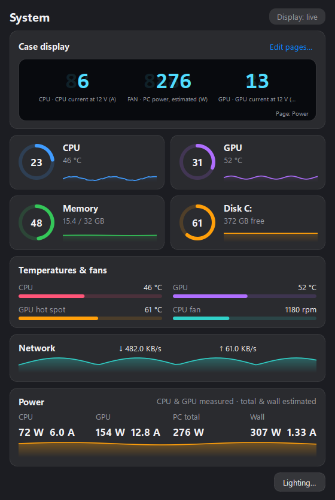
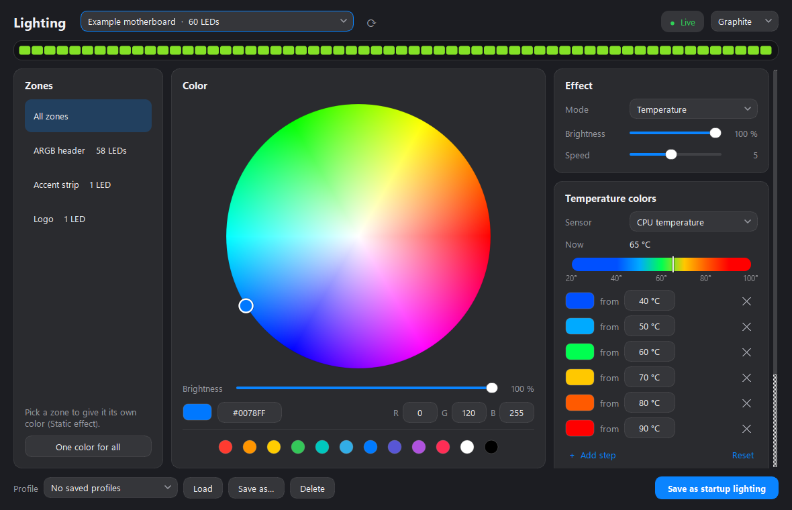
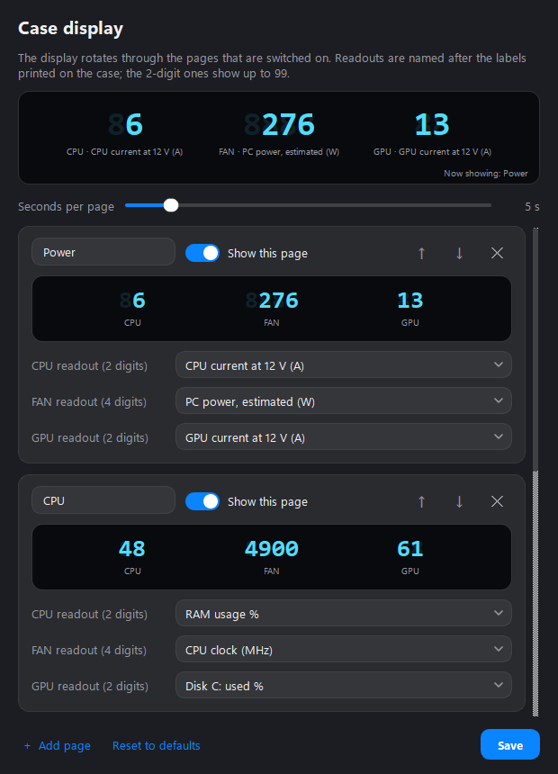

<div align="center">

# CaseView

**Drive your PC case's front display and RGB lighting from your own sensors.**
**A free, open-source, low-overhead replacement for vendor display apps on Windows.**

[](https://github.com/OWNER/caseview/actions/workflows/ci.yml)
[](LICENSE)




</div>

> **Not affiliated with any case, display, motherboard or software vendor.** Brand and product names are used only to identify compatible hardware.

---

## Contents

- [Features](#features)
- [Supported hardware](#supported-hardware)
- [Screenshots](#screenshots)
- [Requirements](#requirements)
- [Install](#install)
- [Usage](#usage)
- [Case display pages](#case-display-pages)
- [Lighting](#lighting)
- [Phone access](#phone-access)
- [Power and current readings](#power-and-current-readings)
- [Configuration](#configuration)
- [Resource use](#resource-use)
- [How it works](#how-it-works)
- [Troubleshooting](#troubleshooting)
- [Contributing](#contributing)
- [License](#license)

## Features

- **Case display:** live CPU, GPU, memory, storage, clock, power and current readings on the case's front panel, with **rotating pages** you design (e.g. Power → CPU → GPU → Temp).
- **Firmware-aware:** works around known display firmware quirks, so the panel always shows the right digits.
- **Case RGB:** static colors, per-zone colors, temperature color steps (blue → green → yellow → red), breathing, color cycle, rainbow wave and an overheat alert, through [OpenRGB](https://openrgb.org).
- **Dashboard widget:** a popup above the tray with ring gauges, history sparklines, temperatures, fans, network and power.
- **Taskbar stats bar:** a compact, draggable, always-on-top strip with CPU / GPU / RAM / fan / power.
- **Phone access (optional):** check stats and change lighting and display pages from your phone on your home network, protected by a PIN.
- **Power and current:** measured CPU and GPU watts, current on the 12 V rails, and estimated whole-PC and wall-socket power.
- **Read-only by design:** CaseView never changes fan curves, clocks or voltages. A test fails the build if any fan- or clock-control call appears in the code.
- **Plays nicely with vendor apps:** detects the vendor's display app, pauses while it runs (or closes it, if you choose) and takes the display back afterwards.
- **Light on resources:** windows do nothing while closed, and sensors are read lean and cached. See [Resource use](#resource-use).

## Supported hardware

| Device | Interface | Notes |
|---|---|---|
| **Crystal X V331** case display (`5131:2007`) | USB HID | Three readouts: 2 digits / 4 digits / 2 digits. [Protocol notes](docs/protocol-crystalx-v331.md) |
| Motherboard / RGB controllers supported by **OpenRGB** | OpenRGB SDK (TCP) | Anything OpenRGB can drive: ARGB headers, fans, strips |

Sensors come from [LibreHardwareMonitor](https://github.com/LibreHardwareMonitor/LibreHardwareMonitor) (Intel/AMD CPUs, NVIDIA/AMD/Intel GPUs, most Super I/O fan chips).

**Your display isn't listed?** Run `caseview list-devices` and open a [*New display support* issue](../../issues/new/choose). See [Adding a display](docs/adding-a-display.md).

## Screenshots

| Lighting | Case display pages |
|---|---|
|  |  |

Taskbar stats bar:


## Requirements

- Windows 10 or 11 (64-bit)
- Python 3.12+ (when running from source)
- [PawnIO](https://pawnio.eu): the signed driver LibreHardwareMonitor uses for CPU and motherboard sensors. Install it once.
- **Administrator rights** for CPU temperature, CPU power and motherboard fan readings. GPU readings work without them.
- [OpenRGB](https://openrgb.org) with its **SDK server** enabled, if you want lighting control

## Install

From source:

```powershell
git clone https://github.com/OWNER/caseview.git
cd caseview
python -m venv .venv
.venv\Scripts\activate
pip install -e .
python -I tools/fetch_lhm.py      # downloads LibreHardwareMonitorLib from NuGet into vendor/
```

A signed Windows installer is planned (see the [roadmap](docs/ROADMAP.md)).

## Usage

Close the vendor's display app first, or let CaseView pause for it (see [Configuration](#configuration)). Then, from an **administrator** terminal:

```powershell
caseview tray            # run in the system tray (display + lighting + widgets), all day
```

| Command | What it does |
|---|---|
| `caseview tray` | Tray app: dashboard, stats bar, case display pages, lighting, phone access |
| `caseview rgb` | Open the lighting window on its own |
| `caseview run -v` | Drive the display and lighting from the terminal, no UI |
| `caseview sensors [--all]` | List sensor readings and what each readout would show |
| `caseview list-devices` | List USB HID devices and mark supported displays |
| `caseview config show \| path \| init` | Show, locate or create the settings file |
| `caseview config slot <readout> <source>` | Choose which hardware sensor feeds a readout |
| `caseview send …` / `caseview test-pattern` | Send fixed values or a test pattern to the display |

**Start with Windows:** tray menu → *Start with Windows*. This creates a Task Scheduler logon task with highest privileges, so sensors work without a UAC prompt at every boot.

## Case display pages

The display rotates through pages; each page decides what the three readouts show. Defaults:

| Page | 2-digit readout | 4-digit readout | 2-digit readout |
|---|---|---|---|
| **Power** | CPU current at 12 V (A) | PC power, estimated (W) | GPU current at 12 V (A) |
| **CPU** | RAM usage % | CPU clock (MHz) | Disk C: used % |
| **GPU** | GPU usage % | GPU core clock (MHz) | VRAM usage % |
| **Temp** | CPU temperature | CPU fan (rpm) | GPU temperature |

Edit them in **tray menu → Case display…**, from the dashboard (*Edit pages…*), or on your phone. You can rename, switch off, reorder, add and remove pages, and set the seconds per page. The 2-digit readouts show up to 99. The labels printed on the case don't change.

## Lighting

Open **Lighting…** from the tray. Pick a device and zone, choose a color on the wheel (or type hex/RGB), and pick an effect:

- **Static**, with optional per-zone colors
- **Temperature:** color steps such as 40 °C blue → 60 °C green → 70 °C yellow → 80 °C orange → 90 °C red, blended or in solid bands
- **Breathing**, **Color cycle**, **Rainbow wave**, **Off**
- **Overheat alert:** flashes above a temperature you set, on top of any effect

Save setups as **profiles** and switch between them from the tray. *Save as startup lighting* makes the current setup the default.

> If your case has a physical lighting button and a hub, connect the hub's 3-pin **5 V ARGB** cable to the motherboard's ARGB header. Never use a 4-pin 12 V RGB header, which will damage addressable LEDs. Many hubs need a long press on the case button to switch to motherboard sync.

## Phone access

Tray menu → **Phone access → Allow phone access**. The menu shows a link (`http://<this-pc>:8765`) and a 6-digit PIN. Open the link on a phone that's on the same network.

Security model:
- Off by default. When enabled, it answers **private-network addresses only** (home Wi-Fi/LAN).
- Every API call needs the PIN. Five wrong PINs lock that address out for a minute. *New PIN* changes it instantly.
- Plain HTTP on your LAN, with no cloud and no account. Don't forward the port to the internet.
- When Windows asks, allow it on **private networks** only.

## Power and current readings

| Reading | Source | Accuracy |
|---|---|---|
| CPU power (W) | CPU package power sensor | Measured (admin) |
| GPU power (W) | GPU board power sensor | Measured |
| CPU / GPU current (A) | watts ÷ 12 V (both are fed from the PSU's 12 V rails) | Good |
| PC power (W) | CPU + GPU + `other_watts` | Estimate |
| Wall power (W) | PC power ÷ `psu_efficiency` | Estimate |
| Wall current (A) | wall power ÷ `mains_voltage` | Estimate |

Software can't measure the real draw at the wall unless the PSU reports it. For exact numbers, use an energy-monitoring smart plug. Smart-plug support is on the [roadmap](docs/ROADMAP.md).

## Configuration

Settings live in `%APPDATA%\CaseView\config.toml`. Most of them can be changed from the UI. See [docs/configuration.md](docs/configuration.md) for every option. A short example:

```toml
[display]
on_conflict = "wait"        # vendor app running: "wait" for it to exit, or "stop" it (admin)
page_seconds = 5
sensor_interval_s = 2.0

[[pages]]
name = "Power"
cpu_temp = "cpu_amps"
cpu_fan = "total_power"
gpu_temp = "gpu_amps"

[power]
mains_voltage = 230         # 120 in North America
psu_efficiency = 0.90
other_watts = 50

[rgb]
enabled = true
effect = "temperature"
```

## Resource use

Measured on a 20-core Intel desktop, tray running with real sensors and the stats bar:

| | |
|---|---|
| CPU | ~2.7 % of **one** core (≈0.1 % of the whole CPU) |
| RAM | ~100 MB private: Python + Qt + the .NET runtime that LibreHardwareMonitor needs |

Closed windows do no work. A planned native background service targets ~35–45 MB (a [spike](docs/low-ram-plan.md) measured 32 MB for the sensor part).

## How it works

```
LibreHardwareMonitor (+ PawnIO) ─┐
psutil (CPU/RAM/disk/network) ───┼─► engine ──► display driver ──► USB HID ──► case display
                                 │      │
                                 │      ├────► RGB effects ──► OpenRGB SDK ──► LEDs
                                 │      └────► tray · dashboard · stats bar · phone API
```

- `src/caseview/drivers/`: display drivers (plugins via the `caseview.drivers` entry point)
- `src/caseview/sensors/`: read-only sensor providers
- `src/caseview/rgb/`: our own MIT-licensed OpenRGB SDK client and effects
- `src/caseview/core/`: engine, config, metrics, phone server, autostart
- `src/caseview/ui/`: PySide6 tray, dashboard, stats bar, lighting and display windows

## Troubleshooting

| Problem | Fix |
|---|---|
| CPU temperature / power blank | Run as administrator and install PawnIO |
| Display shows the vendor app's numbers | The vendor app is running. Exit it from its tray icon, or set `on_conflict = "stop"` |
| Lights don't change | Start OpenRGB with the SDK server on; check the hub is in motherboard-sync mode |
| `LibreHardwareMonitorLib.dll not found` | Run `python -I tools/fetch_lhm.py` |
| Phone can't connect | Same network? Allowed through the firewall on private networks? Correct PIN? |

## Contributing

Contributions are welcome, especially **support for more case displays**. See [CONTRIBUTING.md](CONTRIBUTING.md) and the [Code of Conduct](CODE_OF_CONDUCT.md). Security issues: see [SECURITY.md](SECURITY.md).

## License

[MIT](LICENSE). Third-party components keep their own licenses: LibreHardwareMonitor (MPL-2.0, downloaded at build time, not committed), PySide6 (LGPL-3.0), hidapi, psutil, pythonnet.
